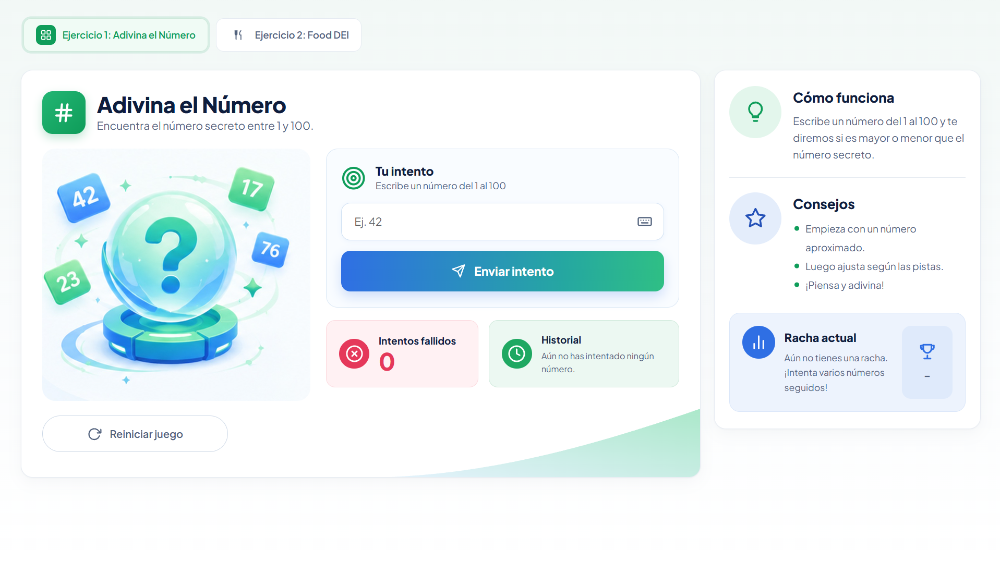
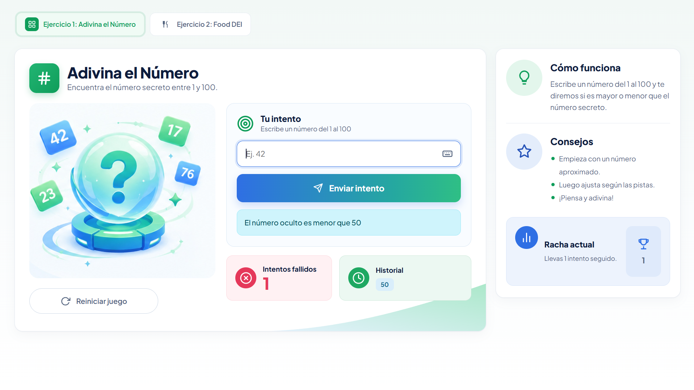
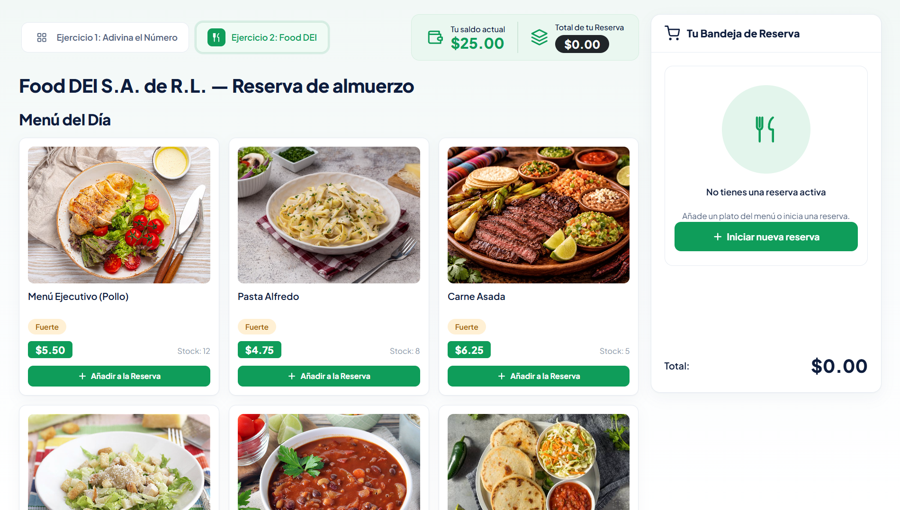
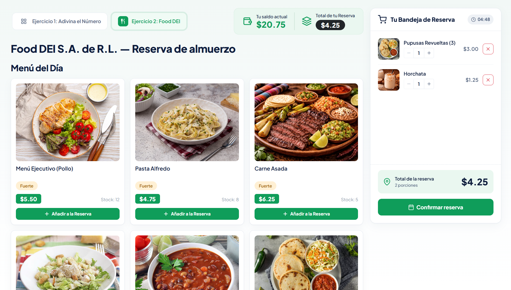
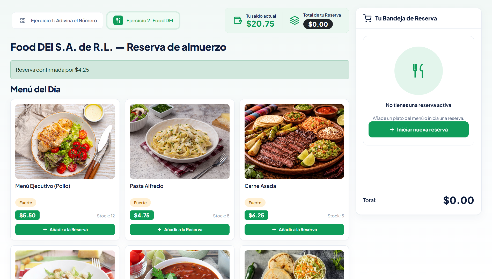

# Evaluación II — Programación Web

**Ciclo 02, 2026**

## Integrantes

| # | Nombre | Carnet |
|---|--------|--------|
| 1 | Astrid Adamaris Alonzo Gómez | 00091525 |
| 2 | Ángel Gustavo Monterrosa Cisneros | 00048825 |
| 3 | Yukio Alberto Ogawa Urquilla | 00171625 |
| 4 | Rubén Eliseo Martínez Pérez | 00076325 |

## Descripción

Este repositorio contiene la solución de la **Evaluación II de Programación Web**, desarrollada como un monorepo compuesto por una API REST y una aplicación web.

```text
evaluacion2/
├── backend/   → API REST
└── frontend/  → Aplicación web
```

### Tecnologías

- **Backend:** Node.js, Express
- **Frontend:** React, Vite, Reactstrap
- **Comunicación:** API REST mediante HTTP

## Capturas de la aplicación

### Ejercicio 1 — Adivina el Número

Pantalla principal del juego:

<p align="center">
  
</p>

Resultado de un intento:

<p align="center">
  
</p>

### Ejercicio 2 — Food DEI S.A. de R.L.

Menú disponible:

<p align="center">
  
</p>

Reserva con alimentos seleccionados:

<p align="center">
  
</p>

Reserva confirmada:

<p align="center">
  
</p>

## Instalación y ejecución

Se requiere **Node.js 20 o superior**.

### Backend

Desde la carpeta raíz del proyecto:

```bash
cd backend
npm install
npm run dev
```

El servidor estará disponible en:

```text
http://localhost:3000
```

### Frontend

En una segunda terminal:

```bash
cd frontend
npm install
npm run dev
```

La aplicación estará disponible en:

```text
http://localhost:5173
```

### Configuración de la API

El frontend utiliza `http://localhost:3000` como URL de la API por defecto.

Para modificarla, crear el archivo `frontend/.env` a partir de `frontend/.env.example`:

```bash
VITE_API_URL=http://localhost:3000
```

## Ejercicio 1 — Adivina el Número

El juego permite realizar intentos para encontrar un número oculto.

### Endpoints

| Método | Ruta | Body | Respuesta |
|--------|------|------|-----------|
| `POST` | `/guess` | `{ "numero": 50 }` | `{ resultado, mensaje }` |
| `POST` | `/reset` | — | `{ mensaje }` |

El campo `resultado` puede tomar los siguientes valores:

- `mayor`: el número oculto es mayor que el intento.
- `menor`: el número oculto es menor que el intento.
- `correcto`: el número ingresado coincide con el número oculto.

## Ejercicio 2 — Food DEI S.A. de R.L.

Este ejercicio implementa un sistema de menú y reservas de alimentos, incluyendo control de inventario, saldo disponible y tiempo límite para confirmar una reserva.

### Endpoints

| # | Método | Ruta | Body | Descripción |
|---|--------|------|------|-------------|
| 1 | `GET` | `/api/menu` | — | Obtiene el menú disponible. |
| 2 | `GET` | `/api/reserva` | — | Obtiene el estado actual de la reserva. |
| 3 | `POST` | `/api/reserva/agregar` | `{ "alimentoId": 101, "cantidad": 1 }` | Agrega un alimento a la reserva. |
| 4 | `PUT` | `/api/reserva/actualizar-porciones/:id` | `{ "cantidad": 3 }` | Actualiza la cantidad de un alimento. |
| 5 | `DELETE` | `/api/reserva/eliminar/:id` | — | Elimina un alimento de la reserva. |
| 6 | `POST` | `/api/reserva/iniciar` | — | Inicia el temporizador de la reserva. |
| 7 | `POST` | `/api/reserva/confirmar` | — | Confirma la reserva y realiza el cobro. |

### Reglas de negocio

- Al agregar un alimento, las unidades correspondientes se descuentan del stock disponible.
- Al eliminar un alimento o reducir su cantidad, las unidades regresan al stock.
- El total de la reserva no puede superar el saldo disponible.
- La reserva cuenta con un tiempo límite para ser confirmada.
- Si el tiempo expira, la reserva se cancela y el stock reservado vuelve a estar disponible.
- Al confirmar la reserva, se descuenta el total del saldo y el stock queda reservado definitivamente.
- Los datos se almacenan en memoria, por lo que se restablecen al reiniciar el backend.

### Tiempo de reserva

El tiempo límite puede configurarse mediante la variable de entorno `RESERVA_MINUTOS`.

Por ejemplo, para utilizar un límite de 30 segundos:

**Linux / macOS / Git Bash:**

```bash
RESERVA_MINUTOS=0.5 npm run dev
```

**PowerShell:**

```powershell
$env:RESERVA_MINUTOS=0.5; npm run dev
```

## Estructura del proyecto

```text
backend/
└── src/
    ├── index.js
    ├── data/
    │   └── menu.js
    ├── routes/
    │   ├── juego.routes.js
    │   ├── menu.routes.js
    │   └── reserva.routes.js
    └── controllers/
        ├── juego.controller.js
        └── reserva.controller.js

frontend/
└── src/
    ├── main.jsx
    ├── App.jsx
    ├── api/
    │   ├── client.js
    │   ├── juegoApi.js
    │   └── reservaApi.js
    └── components/
        ├── juego/
        │   └── AdivinaNumero.jsx
        └── reserva/
            ├── ReservaFoodDei.jsx
            ├── PanelUsuario.jsx
            ├── Temporizador.jsx
            ├── MenuDelDia.jsx
            └── BandejaReserva.jsx
```

## Ejecución

Para utilizar el proyecto es necesario ejecutar simultáneamente el **backend** y el **frontend** en terminales independientes.

```text
Backend   → http://localhost:3000
Frontend  → http://localhost:5173
```

En este proyecto se implementó el uso de Inteligencia Artificial para el desarrollo de la lógica y mejora de la interfaz, así como la IA integrada en Visual Studio Code de completación automática.

Modelos Usados: 
- Claude code Opus 5.5
- GitHub Copilot
